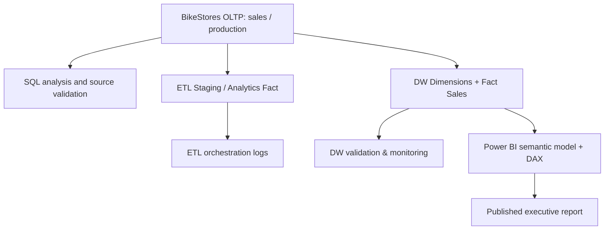

# BikeStores | End-to-End Data Engineering & Executive Analytics

**SQL Server · T-SQL · ETL · Dimensional Modeling · Data Quality · Power BI · DAX**

> **Project status:** An executive Power BI report was published and viewed in Power BI Service. SQL source files, schema-only exports and dashboard outputs have been documented. This repository is a **portfolio/reference release**, **not** a tested one-click production deployment. Power BI scheduled refresh is **not configured** for the local SQL Server LocalDB source.

**العربية:** مشروع متكامل لتحليل مبيعات BikeStores، وتطوير مستودع بيانات، وفحوص جودة البيانات، ثم عرض النتائج في Power BI. [دليل المتابعة بالعربية](docs/GETTING_STARTED_AR.md).

## 1. Business problem

BikeStores sales records are distributed across operational entities such as orders, order items, products, stores, and customers. Management needs a consistent view of sales performance over time, alongside verifiable data-quality checks before trusting executive KPIs.

This project explores how to transform relational sales transactions into structured analytics and an executive report.

## 2. Objectives

- Analyze completed sales orders across stores, products and time periods using T-SQL.
- Build a star-schema analytical model with sales facts and date, product and store dimensions.
- Demonstrate both staging-based sales ETL and a separate warehouse refresh/validation workflow.
- Capture pipeline execution and data-quality checks in SQL tables.
- Present measures and time intelligence in an interactive seven-page Power BI report.
- Reconcile sales aggregates between operational data, the warehouse and the reporting layer.

## 3. Architecture



The `etl` pipeline and the `dw` capstone pipeline are **different workflows** in the supplied SQL. The incremental-load demonstration uses independent lab tables and should not be interpreted as an incremental implementation of `dw.Fact_Sales`.

Read [Data Architecture](docs/DATA_ARCHITECTURE.md) and [ETL Workflow](docs/ETL_WORKFLOW.md).

## 4. Tools and skills

| Area | Tools and techniques |
|---|---|
| Database | Microsoft SQL Server / SSMS / T-SQL |
| Analysis | Joins, aggregations, CTEs, window functions, views, stored procedures |
| Warehouse | Star schema, fact grain, surrogate keys, date/product/store dimensions |
| Data pipelines | ETL, staging, checks, transaction handling, stored-procedure orchestration |
| Practice modules | Incremental watermark lab, SCD type 1/type 2 lab (separate examples) |
| Data quality | Reconciliation, missing dimension members, invalid quantities and discounts, execution logs |
| Business intelligence | Power BI Desktop, Power BI Service, DAX, slicers, KPI cards, time intelligence |

## 5. Sales model and business rules

- **Fact grain:** one `dw.Fact_Sales` row per `(OrderID, ItemID)` sales line.
- **Included sales:** `sales.orders.order_status = 4` (completed orders), as used in the supplied ETL and DW load scripts.
- **Net sales revenue:** `quantity × list_price × (1 - discount)`; revenue **is not profit**.
- **Warehouse relationships:** `dw.Fact_Sales` references `dw.Dim_Date`, `dw.Dim_Product` and `dw.Dim_Store` through keys enforced in exported DDL.

Detailed tables, keys and constraints: [Data Architecture](docs/DATA_ARCHITECTURE.md).

## 6. Dashboard KPI snapshot

These are values previously observed in the user's BikeStores Power BI report, not newly calculated by this repository. They must be rechecked against the same database snapshot and filter context.

| KPI | Dashboard snapshot |
|---|---:|
| Net Revenue | **$6,662,615.24** |
| Completed Orders | **1,445** |
| Average Order Value | **$4,610.81** |
| Units Sold | **6,318** |
| DW Fact Rows | **4,214** |
| Duplicate Fact Rows | **0** |
| Orphan Date / Store / Product Rows | **0 / 0 / 0** |
| Revenue Reconciliation Difference | **$0.00** |
| Data Quality Dashboard Status | **PASS** |
| Data Quality Dashboard Score | **100%** |

See [KPI Dictionary](docs/KPI_DICTIONARY.md) and [Data Quality](docs/DATA_QUALITY.md). A dashboard `PASS` is the result of the checks defined there and does not mean that every possible data-quality risk has been excluded.

## 7. Dashboard

The report contains seven pages, including **Store Performance Analytics**, **Time Intelligence & Sales Trends**, **Revenue Growth Diagnostics**, **DW | Executive Overview**, and **DW Health & Data Quality**. The exact names of the remaining pages and screenshot filenames should be confirmed from the PBIX before final publication.

The report was successfully published and opened in Power BI Service. **A publicly shareable report URL has not been supplied**, so this README does not invent one. Screenshots and the `.pbix` file are **not** included automatically in this source-only release; add them only after review and with the right to share them.

[Dashboard pages and screenshot guide](docs/DASHBOARD_PAGES.md)

## 8. Repository contents

```text
.
├── README.md
├── .gitignore
├── docs/
│   ├── DATA_ARCHITECTURE.md
│   ├── ETL_WORKFLOW.md
│   ├── KPI_DICTIONARY.md
│   ├── DATA_QUALITY.md
│   ├── DASHBOARD_PAGES.md
│   ├── REPRODUCIBILITY_AND_LIMITATIONS.md
│   ├── RELEASE_CHECKLIST_AR.md
│   └── GETTING_STARTED_AR.md
├── sql/
│   ├── read_only/
│   ├── business_analysis/
│   ├── schema_snapshots/
│   ├── procedure_definitions/
│   └── view_definitions/
├── screenshots/
└── powerbi/
```

## 9. How to explore the SQL safely

1. Use a separately authorized **test copy** of the BikeStores database containing the original operational `sales` and `production` tables.
2. Browse the schema snapshots and stored-procedure definitions as **reference material**; **do not execute them on a live database**.
3. Run only the `sql/read_only/` queries in SSMS (after reviewing permissions and the target database); compare results to the KPI snapshot above.
4. For full reconstruction, follow [Reproducibility and Limitations](docs/REPRODUCIBILITY_AND_LIMITATIONS.md). A clean database rebuild and pipeline replay have **not yet been verified**.

## 10. Data governance and constraints

- No raw sales/customer dataset or `.bak` backup is bundled.
- The source exports were filtered to exclude SQL-user/role provisioning statements and the personal-path training exercises.
- The SQL source includes data-changing stored procedures as **definitions** and must not be executed without independent review.
- The original SQL Server is `(localdb)\MSSQLLocalDB`, which is not a proven unattended source for Power BI Service refresh; **scheduled refresh remains deferred**.
- **Repository license:** not yet chosen. Check permissions for BikeStores sample data and any third-party content before making the repository public.

## 11. Future improvements

- Verify a full clean-room deployment in an isolated SQL Server database.
- Produce and validate a portable execution order for the source DB, dimensions, fact, procedures, and monitoring.
- Add the final authorized Power BI screenshots and, if desired, a scrubbed PBIX artifact.
- Test an accessible SQL Server instance plus gateway configuration for scheduled refresh.
- Add automated tests and a reproducible CI workflow only after dependency tests pass.
