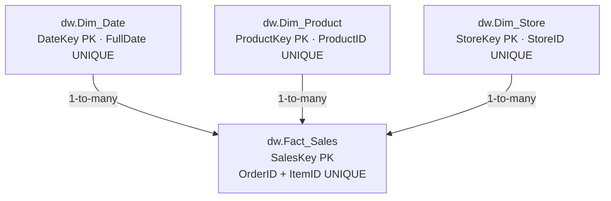

# Data Architecture — BikeStores

**Basis:** the supplied `BikeStores_Database_Schema.sql`, `BikeStores_ETL_Monitoring_Schema.sql`, and the BikeStores SQL master script. This document describes source definitions; no end-to-end deployment has been executed as part of this release.

## Logical layers

| Layer | Source objects | Purpose |
|---|---|---|
| OLTP | `sales.orders`, `sales.order_items`, `sales.stores`; `production.products`, brands and categories | Original sales, order-line and product data |
| ETL staging | `etl.Staging_Sales` | Intermediate completed-order sales lines |
| ETL analytics | `etl.Fact_Sales` | Staging-based analytics fact loaded by `etl.usp_Load_Fact_Sales` |
| Data warehouse | `dw.Dim_Date`, `dw.Dim_Product`, `dw.Dim_Store`, `dw.Fact_Sales` | Star schema for BI |
| Monitoring | `monitoring.Pipeline_Run_Log`, `monitoring.Data_Quality_Results` | Data-quality checks by run |
| Orchestration | `orchestration.Pipeline_Run_Log`, `orchestration.Pipeline_Step_Log` | ETL/capstone process and step execution logs |
| BI | Power BI semantic model / report | KPIs, trends and DW-health views |

## DW star schema

## Warehouse tables and columns (from DDL)

| Table | Key / relationship | Representative attributes |
|---|---|---|
| `dw.Dim_Date` | `DateKey` primary; `FullDate` unique | `CalendarYear`, `CalendarQuarter`, `CalendarMonth`, `MonthName`, `DayOfMonth` |
| `dw.Dim_Product` | `ProductKey` primary; `ProductID` unique | `ProductName`, `BrandName`, `CategoryName`, `ModelYear` |
| `dw.Dim_Store` | `StoreKey` primary; `StoreID` unique | `StoreName`, `City`, `State` |
| `dw.Fact_Sales` | `SalesKey` primary; `(OrderID, ItemID)` unique | `DateKey`, `ProductKey`, `StoreKey`, `Quantity`, `UnitPrice`, `Discount`, `NetRevenue` |

**Grain:** each row of `dw.Fact_Sales` corresponds to one completed order item identified by `(OrderID, ItemID)`. The line count (**4,214**) is distinct from the count of completed orders (**1,445**) in the previous dashboard snapshot.

**Sales scope:** the ETL and warehouse scripts filter `sales.orders.order_status = 4`; they compute `NetRevenue` using `quantity * list_price * (1 - discount)`.

**DB-enforced warehouse foreign keys:** `dw.Fact_Sales.DateKey → dw.Dim_Date.DateKey`, `dw.Fact_Sales.ProductKey → dw.Dim_Product.ProductKey`, `dw.Fact_Sales.StoreKey → dw.Dim_Store.StoreKey`. A SQL Server foreign-key definition does not, by itself, validate BI filter directions; check those in the PBIX separately.

## Nine additional exported tables

| Schema | Tables | Count |
|---|---|---:|
| `etl` | `Fact_Sales`, `Staging_Sales`, `Incremental_Source_Lab`, `Incremental_Target_Lab`, `Incremental_Watermark_Lab` | 5 |
| `monitoring` | `Pipeline_Run_Log`, `Data_Quality_Results` | 2 |
| `orchestration` | `Pipeline_Run_Log`, `Pipeline_Step_Log` | 2 |

**Total exported table definitions: 13 (4 DW + 9 additional).** This is *not* an assertion that the entire OLTP BikeStores schema is exported; the original source tables themselves are not bundled in the release.

### ETL sales objects

`etl.Staging_Sales` and `etl.Fact_Sales` include `order_id`, `item_id`, `order_date`, store and product keys/names, `quantity`, `unit_price`, `discount`, and `net_revenue`; the ETL fact additionally contains `last_loaded_at`. Their primary keys use `(order_id, item_id)`.

### Monitoring and step logs

- `monitoring.Data_Quality_Results.RunID` references `monitoring.Pipeline_Run_Log.RunID` via `FK_DQ_Run`.
- `orchestration.Pipeline_Step_Log.RunID` references `orchestration.Pipeline_Run_Log.RunID` via `FK_Orch_Step_Run`.
- Pipeline logs record run status and timestamps; quality checks record rule name, PASS/FAIL, failed rows and check time.

## Object definition provenance

The exported main schema includes nine views and sixteen non-system business/ETL procedures. Object definitions are placed under `sql/view_definitions/` and `sql/procedure_definitions/` as reference-only scripts. The system diagram stored procedures and training users/roles are excluded from the public candidate.

**Important:** operational BikeStores objects (such as `sales.orders`) must already exist for the stored procedures and views referencing them. Schema snapshots omit the original data and do not provide a verified create-from-zero build.
