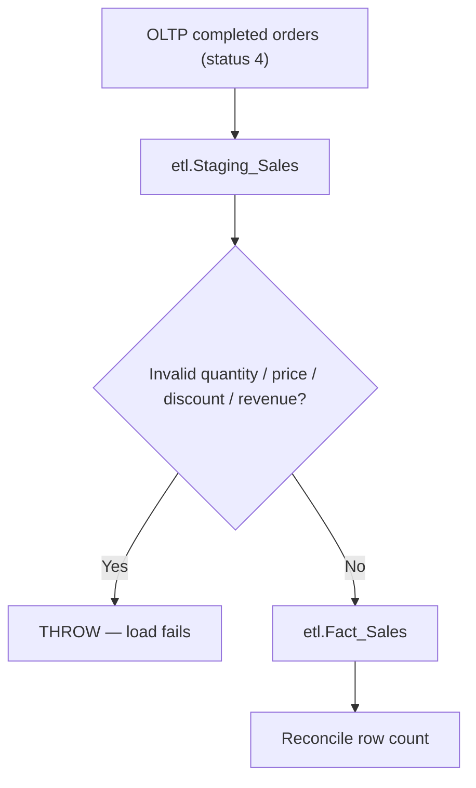
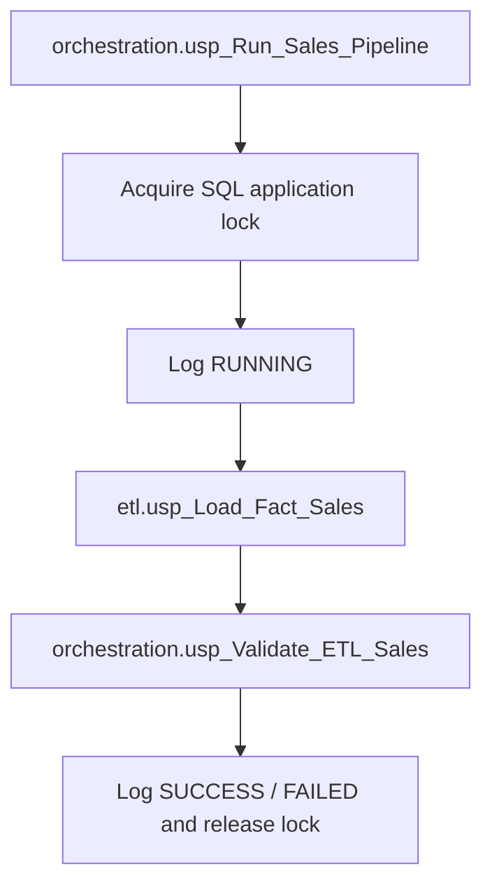
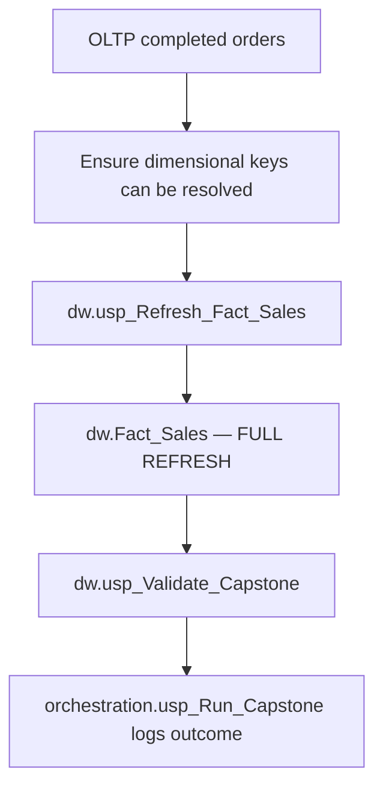
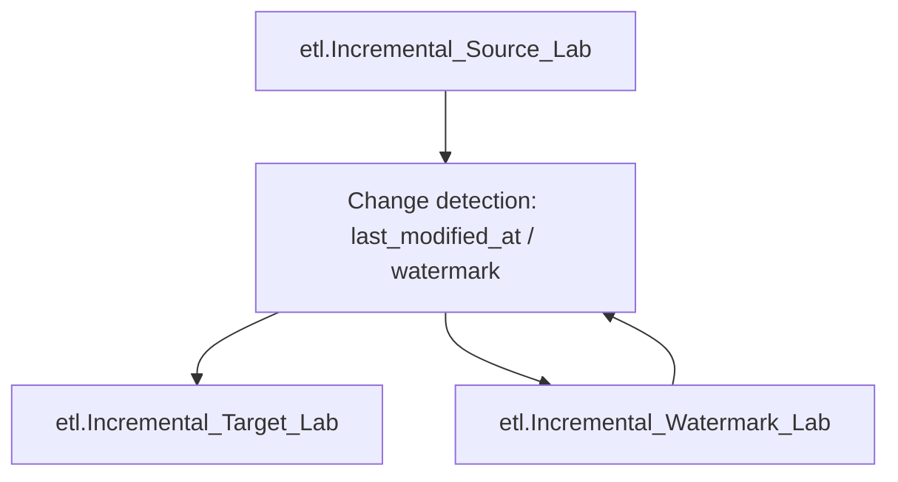

# ETL Workflow — SQL Evidence & Pipeline Boundaries

This document distinguishes workflows that are **separately implemented in the supplied scripts**. It must not be read as proof that every pipeline was deployed as a continuously running production service.

## A. Staging-based Sales ETL — Step 25

Implemented by **`etl.usp_Load_Fact_Sales`**. The procedure:

1. Begins a transaction with `XACT_ABORT ON`.
2. Rebuilds `etl.Staging_Sales` from orders, items, stores and products, filtered to `order_status = 4`.
3. Rejects invalid quantities, negative unit prices, discounts outside 0–1 and negative calculated revenue.
4. Clears and reloads `etl.Fact_Sales` from staging.
5. Performs a row-count comparison and either commits or rolls back and throws on failure.

This flow is a **full refresh of the ETL analytics layer**, not an incremental load.

## B. Sales ETL Orchestration — Step 30

The supplied stored procedure uses `sys.sp_getapplock` to avoid concurrent executions, tracks run/step statuses in `orchestration.Pipeline_Run_Log` and `orchestration.Pipeline_Step_Log`, and invokes the two stored procedures shown above. Application lock and logging behavior have been **inspected in source code**, not benchmarked under load.

## C. Warehouse Refresh & Capstone — Steps 27 and 31

The master SQL script includes loading `dw.Dim_Product`, `dw.Dim_Store`, and `dw.Dim_Date` prior to the warehouse fact in Step 27. The capstone's procedure `dw.usp_Refresh_Fact_Sales` validates dimensional coverage then executes `DELETE FROM dw.Fact_Sales` followed by `INSERT INTO dw.Fact_Sales` from completed OLTP orders. Its operation is **full refresh**.

`orchestration.usp_Run_Capstone` executes the fact refresh and `dw.usp_Validate_Capstone`, recording status and step details in the orchestration log. `dw.usp_Production_Quality_Gate` is defined separately and runs validations; do not assume it is automatically invoked by every path unless the corresponding call is present in the tested deployment.

**Source caution:** the Step 31 training/capstone section contains non-SQL outline text and data-changing operations; it has not been published here as a single executable migration file.

## D. SQL Data Quality Monitoring — Step 29

`monitoring.usp_Run_Data_Quality` creates a monitoring run, calculates checked warehouse rows, and records PASS/FAIL for three code-defined rules:

| Rule in SQL monitoring procedure | Source check |
|---|---|
| Invalid Quantity | `dw.Fact_Sales.Quantity <= 0` |
| Invalid Discount | `dw.Fact_Sales.Discount NOT BETWEEN 0 AND 1` |
| Missing Product Dimension | Left join from fact to `dw.Dim_Product`, missing member |

The procedure determines run status based on failure records. **Power BI DW Health uses additional measures** (e.g. order completeness, row duplicates, all three dimension orphans, revenue reconciliation); do not equate the three logged SQL rules with the full BI Quality Score.

## E. Incremental Loading Lab — Step 26 (separate demonstration)

The supplied code defines an independent lab with `etl.usp_Incremental_Load_Lab` and three `Incremental_*_Lab` tables. This demonstrates incremental watermark handling **in lab data**. It is **not** integrated into the `dw.Fact_Sales` capstone refresh shown above.

## F. Slowly Changing Dimensions lab — Step 28

The master script includes SCD Type 1 and Type 2 demonstrations. Those examples are training sections, and the exported four-table DW star schema should not be described as implementing historical product/store SCD Type 2 based on this evidence alone.

## Operational checklist before any replay

- Obtain an authorized operational BikeStores database snapshot.
- Provision a separate test database and check compatibility of SQL Server options.
- Confirm schema, table, view and procedure dependency order.
- Inspect all `CREATE`, `TRUNCATE`, `DELETE`, `UPDATE`, `INSERT`, `EXEC`, security and backup commands.
- Take a backup of the **test** system before DDL or ETL changes.
- Perform reconciliation after loading, not only visual inspection of dashboards.
- Do not claim refresh SLAs, daily schedules, uptime or unattended orchestration without independent evidence.
